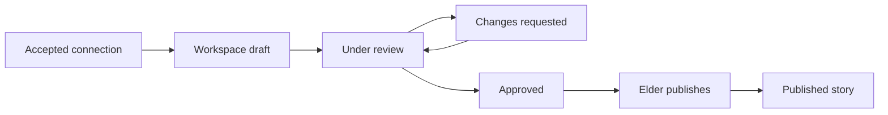
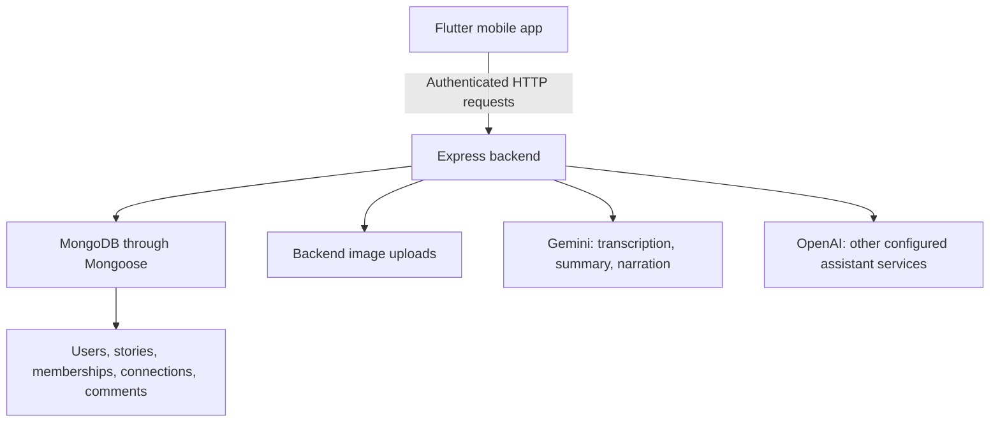

# YATHRA: product explanation and two-video guide

Prepared on 14 October 2026 from the repository and the changes made in this session. This guide describes the implemented prototype, its intended benefits, and remaining limitations. It is not an external competitor study or a user-impact evaluation.

## 1. What is YATHRA?

YATHRA is a cultural preservation application that connects elders, young people, and readers around cultural knowledge. Its content can include recipes, songs, language expressions, local history, practices, and personal memories.

An elder contributes knowledge directly or collaborates with a youth. A youth can discover stories, request a connection, interview an elder, and prepare a contribution for elder review. Readers discover published material through feeds, categories, and communities.

The central purpose is to turn knowledge that may remain in conversations or family memories into readable, organised contributions while retaining the contributor's original narrative.

Suggested one-sentence explanation:

> YATHRA helps generations preserve cultural knowledge through elder-led storytelling, youth collaboration, and optional AI assistance.

The project addresses a practical problem: memories and cultural practices can be difficult to document, discover, and pass on. Typing can also be a barrier for some contributors. YATHRA offers recording conversion, short previews, and a collaborative review process to support that work. Actual accessibility and preservation impact still need representative user testing.

## 2. Participants and responsibilities

| Participant | Main actions | Responsibility |
| --- | --- | --- |
| Elder | Publish stories, accept connections, chat, review contributions | Decide whether a contribution represents the knowledge appropriately |
| Youth | Explore, connect, ask questions, draft collaborative content | Document respectfully and revise according to elder feedback |
| Reader | Discover and read published stories | Understand the original content and its context |
| AI services | Transcribe recordings, generate previews, narrate text, suggest interview questions | Assist expression and organisation; never certify historical truth |

Registration and login establish identity and role. Protected backend actions use the signed-in account and token. An accepted connection grants its participants access to the collaboration; having an elder role alone does not authorise review of somebody else's project.

## 3. The complete individual elder journey

1. Register or sign in as an elder.
2. Open Profile and edit name, biography, location, preferred language, and profile picture.
3. Explore a community, read its description, and follow it.
4. Open Add Story from Home or a followed community.
5. In Story details, enter the title, category, and story language.
6. In Tell your story, type the original narrative or record speech.
7. Stop recording and choose Convert Recording to Text. The app uploads the saved recording; the elder does not speak a second time.
8. Correct the returned text. The transcript is editable, and conversion errors allow retry.
9. Use Listen to Story to hear the written text and check it by listening.
10. Continue to Context. Add optional location, community, time period, banner image, and additional photos.
11. Continue to AI. Generate a short summary or write a preview manually. Review it and tick the approval checkbox, or skip it.
12. Continue to Review and publish the story.
13. Refresh the feed. An approved, nonempty summary appears as the story preview; otherwise the card uses the original text.
14. Open the card to read the original narrative, metadata, and photos.
15. Swipe the additional-photo strip sideways and tap a photo for an enlarged gallery view.
16. Use Listen to Story in the elder detail page to hear the displayed original story text.
17. Add a comment. Comments are saved against that particular story and do not come from a shared sample list.

The elder feed, community stories, and category stories now lead to the same elder dynamic detail page. Story cards receive the publishing author's name and saved avatar from the backend. Updating a profile picture does not require editing every story.

## 4. Youth-to-elder collaboration journey

1. A youth discovers an elder and requests a connection.
2. Where a request includes a community, the backend validates that community and the youth's membership.
3. The elder reviews the pending request and accepts or rejects it.
4. Accepted participants exchange persisted messages about a cultural topic.
5. Optional conversation starters help begin the interview. Follow-up suggestions use recent messages to propose further questions.
6. A participant opens My Projects and the accepted connection's workspace.
7. Add Content uses the shared story form, with the project community carried into the editor.
8. The youth saves the contribution and sends it for review.
9. The connected elder checks the original wording, context, images, category, language, and preview.
10. The elder requests changes or approves. The youth revises when changes are requested.
11. The connected elder publishes the approved contribution, creating a published Story record.

Individual elder publishing is a separate route. It does not enter this collaborative review status machine. A project can contain more than one contribution.

## 5. Components and their value

| Component | What it does | Demonstration point |
| --- | --- | --- |
| Role-based shell | Presents elder or youth screens | Show the two participant perspectives |
| Elder Home | Loads published stories and offers creation | Open a real database story |
| For You | General discovery feed | Avoid calling it AI personalisation |
| Following | Filters by saved community memberships | Follow a community, then show its stories |
| Explore | Community and category discovery | Open the same story from another entry point |
| Community details | Description, membership, member count, stories | Explain how posting context links a story to a community |
| Four-step Add Story | Story, Context, AI, Review | Show the complete publishing sequence |
| Recording conversion | Saved audio to editable original text | Speak once, stop, convert, then correct words |
| Text reading | Written text to generated narration | Review by listening without speed or language controls |
| Story card | Author/avatar, banner, preview, language and metadata | Show the approved summary without replacing the original |
| Elder story details | Original story, metadata, summary, reading, gallery, comments | Swipe photos and demonstrate story-specific comments |
| Connections and notifications | Requests and accepted relationships | Distinguish pending from accepted |
| Chat | Persisted interviewing conversation | Select a generated suggestion manually |
| My Projects | Collaborative contributions and review controls | Demonstrate changes requested and approval |
| Profile | Identity, image, contributions, accepted connection counts | Update an avatar and refresh a story card |
| Map | Cultural-place exploration | Explain that its current place/story data is still sample-based |

Story language choices are English, Sinhala, and Tamil. That is not a claim that the entire interface is translated. The previous question marks in seeded Sinhala/Tamil text were a text-encoding problem; the seeded article text was repaired using UTF-8.

## 6. AI features: what happens and why

### Saved-recording transcription

The phone records an M4A file. Convert uploads that file to the authenticated YATHRA backend, which sends it to Gemini. The returned transcript populates editable story text. This supports contributors who prefer oral expression.

The configured transcription model is selected through GEMINI_TRANSCRIPTION_MODEL; its current default is gemini-3.5-transcribe. Gemini conversion currently limits recordings to 14 MB. Network speed, recording length, provider load, and account quota affect latency. The app does not promise instant conversion or perfect language recognition.

### Human-reviewed story summary

The backend sends the title, original text, and selected language to Gemini. Instructions ask for one or two sentences within 700 characters, using only supplied facts. The backend rejects an empty or oversized result.

GEMINI_SUMMARY_MODEL currently selects gemini-3.5-flash-lite. The elder can edit, approve, regenerate, or skip the preview. Approval is invalidated when the source changes. Original text and summary are saved separately. The preview becomes visible only when it is approved and nonempty.

The benefit is easier discovery of a longer story. It is not AI verification of history, cultural authenticity, or recipe/medical safety.

### Text-to-speech review

The Add Story form and elder detail page send written text to the authenticated story-speech endpoint. Gemini generates WAV narration and Flutter plays it. GEMINI_TTS_MODEL currently selects gemini-3.8-flash-tts.

The elder detail action reads story text, rather than relying on the original recording path. It provides Listen and Stop without speed or language selectors. Narration requires internet and provider access; pronunciation and complete language coverage need device testing.

### Interview assistance

Conversation starters use community/topic and role. Follow-up questions use the recent chat context. The intended result is three to five respectful questions that can encourage further detail.

These actions still use the OpenAI culture-assistant service. They have not been migrated simply because voice conversion and summary generation now use Gemini. The relevant OpenAI key, model access, and quota must work. Some question interfaces have deterministic fallback prompts.

Suggestions are not sent automatically. The user chooses what to ask.

### Other AI capabilities and integration limits

Youth services include translation and cultural-term explanation. Their provider configuration remains separate from Gemini voice/summary migration. Verify them live before recording claims of successful operation.

Chat-to-story drafting has backend capability and participant consent checks. Each new message resets consent. A complete current UI journey from consent through generated workspace draft has not been established; present it as a backend capability or planned integration, not a completed user demonstration.

Category/tag suggestion logic exists in the assistant backend. Its former workspace control was removed during shared-form alignment. Do not show it as an active shared-form feature.

## 7. Technical architecture

Flutter manages navigation, forms, recording, media selection, playback, and rendering. Express validates requests, identity, relationships, and input. Mongoose models provide persistent records in MongoDB.

Important records:

- User: name, role, password hash, profile information and avatar.
- Story: original text, approved preview/status, category, language, context, photos, author and contributors.
- CommunityMembership: persistent following relationships.
- Connection: participants, messages, accepted status, workspace items and consent.
- StoryComment: story ID, authenticated author, author name, text and timestamps.
- Community definitions: curated JSON catalogue with stable IDs.

Provider keys and database credentials belong in backend environment configuration. Do not show .env during recording. Story/chat/audio actions send their inputs to external AI services when requested. Prompting and human review cannot guarantee factual accuracy.

Images currently use backend uploads or source URLs. A shared MongoDB database does not make files on one developer's laptop available from another machine. Production needs a shared media-storage strategy and a deployed backend URL.

## 8. Defensible differences and novelty

Present the distinctive contribution as a workflow combination:

1. **Elder-led review:** collaborative work requires the connected elder's approval before publication.
2. **Intergenerational documentation:** youth participation supports interviewing and preparation, rather than replacing the elder's role.
3. **Original preservation:** the original narrative remains distinct from its optional discovery preview.
4. **Multiple ways to contribute:** recording conversion and editable text support different expression preferences.
5. **Interview-oriented AI:** prompts help a person ask better questions about cultural memories.
6. **Community-linked discovery:** a saved community ID and membership determine Following and community results.
7. **Consistent contribution structure:** individual and collaborative stories use the shared form and metadata.
8. **Multilingual and place-aware direction:** three story languages and a map component support a culturally situated preservation goal, with current map limits made clear.

These are design contributions. A general social feed, transcription, summarisation, and maps are established technologies. The repository has no evidence that YATHRA is the world's first, has features nobody else offers, or measurably outperforms alternatives.

For a comparison slide, contrast purposes rather than make unverified competitor claims: general posting versus a cultural documentation workflow; unrestricted collaboration versus elder review; generated content alone versus retained original narratives. Say that formal competitor and literature reviews are future validation work.

## 9. Video 1: technical demonstration, approximately 8–10 minutes

| Time | Screen/action | Suggested narration |
| --- | --- | --- |
| 0:00–0:40 | Title and Home | “YATHRA connects elders and young people to document cultural knowledge. This demonstration shows the implemented prototype and identifies remaining work.” |
| 0:40–1:20 | Elder login and Profile | “The role selects the elder experience. Profile editing saves identity and an uploaded picture.” |
| 1:20–2:00 | Explore, follow community, Following | “Community membership is persisted. Following requests stories associated with followed community IDs.” |
| 2:00–3:30 | Add Story: record, stop, convert, edit | “The saved recording is sent through the backend to Gemini. The returned text stays editable and becomes the original written story.” |
| 3:30–4:20 | Context, photos, summary approval | “Context organises the contribution. Gemini proposes a preview. Human approval controls whether that preview is used.” |
| 4:20–5:15 | Publish, card, details, gallery, read aloud | “The preview and original are separate. The same elder page opens from the feed, community, and category. Additional photos scroll horizontally.” |
| 5:15–5:50 | Comment on story A, open story B | “Comments are persisted using the story ID. A comment on this record does not appear on another post.” |
| 5:50–7:30 | Youth request, elder accepts, chat, project review | “An accepted relationship permits shared work. Youth submission leads to elder review, changes, approval, and publication.” |
| 7:30–8:30 | Architecture diagram and selected code | “Flutter calls Express. MongoDB stores records. Gemini handles these voice and summary actions; other services keep their OpenAI configuration.” |
| 8:30–9:00 | Limitations and next steps | “This is a working prototype with further work needed for production media, privacy enforcement, individual drafts, social persistence, map integration, and user validation.” |

Show implementation evidence rather than only taps: a successful publish followed by reloading; comment A absent on story B; saved profile after reopening; contribution status transitions; an error handled without losing the original text.

If you inspect MongoDB or network traffic, expose only the relevant fields and status. Hide tokens, credentials, emails, and private conversations. Use consenting test participants and nonpersonal recordings.

## 10. Video 2: promotional video, approximately 75–90 seconds

### 0:00–0:15 — The reason

Visual: an elder talking, a recipe notebook, a family photograph, or a culturally relevant place.

Voiceover: “A recipe. A song. A word we grew up hearing. Our cultural knowledge lives in the people around us. How can we help the next generation discover it?”

### 0:15–0:35 — Introduce YATHRA

Visual: Home, categories and a community story.

Voiceover: “Meet YATHRA: a place for elders and young people to share and document cultural knowledge through stories, communities, and collaboration.”

### 0:35–0:55 — Show the contribution

Visual: record, convert, edit, summary approval, then original story.

Voiceover: “Speak your story or write it. Turn a recording into editable text. Review an optional AI preview while keeping the original narrative. Listen to your words before sharing them.”

### 0:55–1:15 — Show the human connection

Visual: youth connection request, conversation, contribution review.

Voiceover: “Young people can ask questions and help prepare a contribution. Elders review collaborative work before it is published. Knowledge is shared through a relationship, with the elder's voice at the centre.”

### 1:15–1:30 — Close

Visual: finished story, relevant photos and logo.

Voiceover: “Discover a tradition. Document a memory. Share it with another generation. YATHRA—carry our stories forward.”

Closing caption: “Cultural preservation prototype.” Use an app download or public registration call to action only when a real release exists.

## 11. A consistent demonstration story

Use one clearly fictional test memory about making a Vesak lantern with a parent. Enter a short title, English story text, Traditional Practice, a truthful test location, and photos you own. Make a second contribution with another topic to show comment separation.

The seeded catalogue now contains 14 sourced reference articles in English, Sinhala and Tamil, with distinct sample contributor names. Those names are fictional test identities; the articles are editorial reference content, not verified interviews by those people. Sources and image references are included. Do not present these accounts as actual elder contributors in either video.

The multilingual posts are different topics, not three translations of the same story. A reference article without an approved summary will show an excerpt; do not claim every existing seed already has an AI-generated preview.

## 12. Claims to use and limits to disclose

| Accurate statement | Avoid |
| --- | --- |
| “AI assists transcription, previews and narration.” | “AI guarantees cultural accuracy.” |
| “Elders approve collaborative publication.” | “Every record has verified historical authenticity.” |
| “Original text is retained separately.” | “AI replaces or reconstructs the elder's memory.” |
| “Following uses community memberships.” | “For You is an AI recommendation system.” |
| “Comments are story-specific and saved.” | “Every like/bookmark/social action is server-backed.” |
| “Workspace drafts are persisted.” | “Individual Save Draft currently saves to MongoDB.” |
| “The map explores cultural places in the prototype.” | “New posts automatically appear at real map markers.” |
| “The app accepts three story languages.” | “Every interface and AI output is fully validated in all languages.” |

Other current limits: elder likes and saved toggles remain local; chat is not verified real-time socket messaging; individual visibility choices do not establish enforced private publishing; original recording upload/shared playback remains incomplete; some Home/map/insight content is illustrative; external image reliability and licensing must be reviewed for public release.

## 13. Recording preparation checklist

1. Test both accounts, provider access, backend connectivity and phone network before recording.
2. Use a short recording and wait for the real result. Edit out waiting time transparently if needed.
3. Prepare an accepted collaboration and a draft to avoid lengthy setup on camera.
4. Refresh feeds after publishing and reopen records to prove persistence.
5. Keep reference article sample identities distinct from real participants.
6. Use appropriately licensed photos/music or media you own. A source image URL is not a licence check.
7. Record readable text and avoid tiny architecture/code captures.
8. Hide .env, API keys, MongoDB credentials, JWTs and personal data.
9. Present incomplete features as future work.
10. Keep the promotional video focused on people and benefits, and the technical video focused on behaviour and evidence.

## 14. Useful code anchors

- frontend/lib/pages/elder/share_story_page.dart: authoring UI, saved recording upload, editable transcript, summary approval and publication.
- frontend/lib/pages/elder/story_details_page.dart: elder article layout, original-text narration, horizontal gallery and comments.
- frontend/lib/widgets/social_story_card.dart and author_avatar.dart: feed rendering and author picture.
- frontend/lib/pages/community_details_page.dart and explore_page.dart: community/category entry points and role-aware detail navigation.
- frontend/lib/pages/culture_connect_pages.dart: connections, chat and workspace UI.
- backend/src/routes/aiRoutes.js: authenticated summary endpoint.
- backend/src/services/geminiSummaryService.js: source-faithful summary prompt and validation.
- backend/src/services/geminiVoiceService.js and routes/transcriptionRoutes.js: Gemini audio actions.
- backend/src/routes/storyRoutes.js and models/Story.js: published records, filtering and preview state.
- backend/src/routes/storyCommentRoutes.js and models/StoryComment.js: per-story persistent comments.
- backend/src/routes/connectionRoutes.js: collaboration review and publication.
- backend/src/services/cultureContentAssistantService.js: OpenAI assistant actions.
- backend/scripts/seed-demo-stories.js: repeatable sourced sample records, with UTF-8 localised text.

Observed validation includes targeted backend tests for profile editing, comments, voice and summary handling, Dart static analysis for changed screens, live Gemini summary/transcription probes, and successful database seeding. This is not a comprehensive production audit, language-quality benchmark, usability trial, or proof that every feature works on every device.
